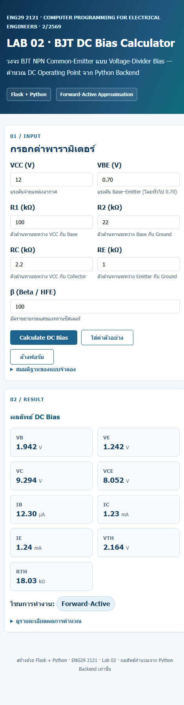
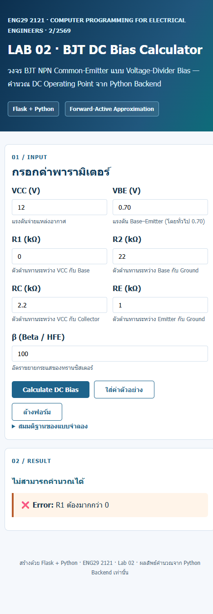
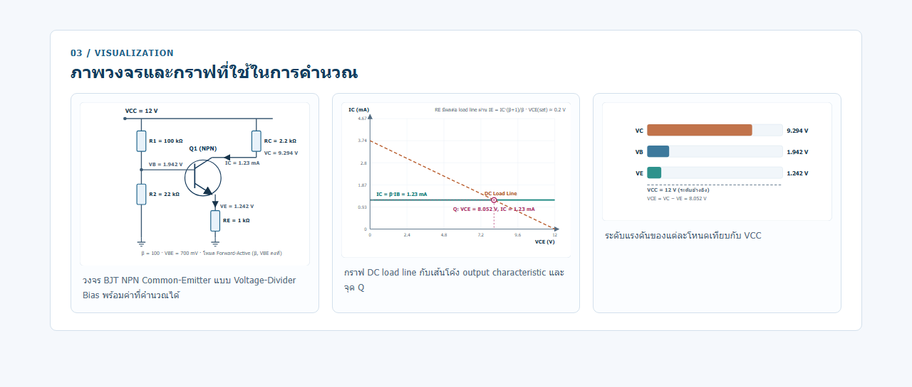

# BJT DC Bias + CE Amplifier Simulator

เว็บแอปพลิเคชัน Flask สำหรับวงจร BJT NPN Common-Emitter:

- **Lab 03 — DC Bias Analytical** คำนวณ **DC Operating Point** แบบประมาณด้วย Python ได้ 3 แบบ:
  **Fixed Bias**, **Emitter Bias (แหล่งจ่ายเดียว)** และ **Voltage-Divider Bias**
- **Lab 04 — CE Amplifier Simulator v1** เชื่อม **ngspice** จริงสำหรับวงจร **CE Voltage Divider อ้างอิงหนึ่งวงจร**:
  DC (`.op`), AC (`.ac`, Bode gain/phase), Transient (`.tran`, Vin/Vout) และกราฟจากผลจำลองจริง
  แยกป้ายผล **Analytical** (สมการประมาณจาก `dc_bias.py`) ออกจาก **SPICE** (ngspice)

ENG29 2121 · Lab 03 + Lab 04

## ภาพรวม

- Frontend: ฟอร์ม HTML + CSS (Jinja template)
- Backend: Flask รับ HTTP request แล้วเรียกฟังก์ชันคำนวณใน Python
- Engineering logic แยกอยู่ใน `dc_bias.py` (ไม่รู้จัก HTML/HTTP)
- **เลือกหน่วยขาเข้าและหน่วยแสดงผลได้** ผ่าน `units.py` (คำนวณภายในยังใช้หน่วย SI เสมอ)
- ภาพประกอบสร้างเองใน `circuit.py` เป็น SVG (ภาพวงจร, กราฟ DC load line, แผนภาพระดับแรงดัน) — ไม่ต้องใช้ไลบรารีภายนอก
- มี automated tests ทั้ง unit test, figure test และ Flask HTTP test

## ข้อกำหนดเบื้องต้น

- Python 3.10 ขึ้นไป
- Git (สำหรับ clone repository)
- **ngspice** (โปรแกรม SPICE ภายนอก) สำหรับฟีเจอร์ Lab 04 — ดูหัวข้อ "Lab 04 — SPICE" ด้านล่าง
  (DC Bias 3 โหมดแบบ Analytical ใช้ได้โดยไม่ต้องมี ngspice)

## การติดตั้งและรัน

```powershell
# 1) เข้าโฟลเดอร์โปรเจกต์
cd "C:\path\to\BJT DC Bias Web App"

# 2) สร้าง virtual environment
python -m venv .venv

# 3) เปิดใช้งาน (Windows PowerShell)
.\.venv\Scripts\Activate.ps1

# 4) ติดตั้ง dependencies
python -m pip install -r requirements.txt

# 5) รันเว็บ
python -m flask --app app run --debug
```

เปิดเบราว์เซอร์ที่ <http://127.0.0.1:5000/>

> หมายเหตุ: ต้องเปิดผ่าน Flask local server เท่านั้น ไม่ใช่ double-click เปิดไฟล์
> `templates/index.html` ด้วย `file://`

## วิธีใช้

1. เลือก **โหมดวงจร** แล้วกด **ใช้โหมดนี้** เพื่อโหลดฟอร์มที่ใช้เฉพาะโหมดนั้น
2. กรอกค่า VCC (V), VBE (V), RC (kΩ) และ β ทุกโหมด
   - **Fixed Bias** — เพิ่ม RB (ค่าเริ่มต้นเป็น MΩ)
   - **Emitter Bias** — เพิ่ม RB (MΩ) และ RE (kΩ)
   - **Voltage Divider Bias** — เพิ่ม R1, R2, RE (kΩ)
3. กด **Calculate DC Bias**
4. ระบบจะแสดง VB, VE, VC, VCE (V), IB (μA), IC/IE (mA) และโซนการทำงาน
   (VTH/RTH เฉพาะโหมด Voltage Divider)
5. หากอินพุตผิดหรืออยู่นอกย่าน Forward-Active จะมี Error/Warning แจ้ง
6. ด้านล่างจะแสดง **ภาพวงจรตามโหมดที่เลือก**, **กราฟ DC load line** พร้อมจุด Q และ **แผนภาพระดับแรงดัน** ของแต่ละโหนด

> ปุ่ม **ใส่ค่าตัวอย่าง** จะกรอกค่าชุดมาตรฐานของโหมดนั้นให้อัตโนมัติ
> (A2: RB = 1 MΩ · A3: RB = 1 MΩ, RE = 1 kΩ) เพื่อทดสอบได้เร็ว
> ปุ่ม **ล้างฟอร์ม** จะเคลียร์ค่าทั้งหมด
> กด **ดูรายละเอียดผลการคำนวณ** เพื่อดูค่ากลางของสมการทุกขั้นตอน

## การเลือกหน่วย

### หน่วยขาเข้า (ตัวเลือกถัดจากช่องกรอก)

| ช่อง | หน่วยที่เลือกได้ |
|---|---|
| VCC, VBE | V, mV |
| R1, R2, RC, RE | Ω, kΩ, MΩ |
| β | ไม่มีหน่วย |

ตัวอย่าง: ถ้ากรอก R1 = 100 และเลือกหน่วย `kΩ` จะเท่ากับ 100,000 Ω
แต่ถ้าเลือก `Ω` ต้องกรอก 100000 ให้ได้ค่าเดียวกัน

### หน่วยขาออก (ส่วน "หน่วยที่ใช้แสดงผล")

| ตัวเลือก | ตัวอย่างผลลัพธ์ |
|---|---|
| แรงดัน = อัตโนมัติ | VB = 1.942 V |
| แรงดัน = mV | VB = 1942.157 mV |
| กระแส = อัตโนมัติ | IC = 1.23 mA, IB = 12.3 µA |
| กระแส = A | IC = 0.001 A, IB = 0.000012 A |

- โหมด **อัตโนมัติ** จะเลือกหน่วยที่เหมาะสมให้แต่ละค่อยโดยอัตโนมัติ
- ตารางรายละเอียดจะแสดงทั้งค่าตามหน่วยที่เลือก และค่า SI เทียบกัน
- หน่วยที่เลือกจะถูกใช้กับภาพวงจรและกราฟด้วย

> ภายในระบบคำนวณทุกอย่างอยู่ในหน่วย SI (V, Ω, A) เสมอ
> การแปลงหน่วยทำที่ขอบระบบใน `app.py` ผ่าน `units.to_si()`

### ค่าตัวอย่างสำหรับทดสอบ

| พารามิเตอร์ | ค่า |
|---|---|
| VCC | 12 V |
| R1 | 100 kΩ |
| R2 | 22 kΩ |
| RC | 2.2 kΩ |
| RE | 1 kΩ |
| β | 100 |
| VBE | 0.70 V |

ผลลัพธ์อ้างอิง (Forward-Active):

| ค่า | ผลลัพธ์ |
|---|---|
| IB | 12.30 μA |
| IC | 1.23 mA |
| IE | 1.24 mA |
| VB | 1.942 V |
| VE | 1.242 V |
| VC | 9.294 V |
| VCE | 8.052 V |

#### A2 · Fixed Bias (RB = 1 MΩ)

ใช้อินพุตร่วม VCC = 12 V, RC = 2.2 kΩ, β = 100, VBE = 0.70 V (ไม่กรอก R1/R2/RE)

| IB | IC | VE | VB | VC | VCE | โซน |
|---|---|---|---|---|---|---|
| 11.30 μA | 1.13 mA | 0 V | 0.700 V | 9.514 V | 9.514 V | Forward-Active |

#### A3 · Emitter Bias (RB = 1 MΩ, RE = 1 kΩ)

ใช้อินพุตร่วมตามข้างบน (ไม่กรอก R1/R2)

| IB | IC | IE | VE | VB | VC | VCE | โซน |
|---|---|---|---|---|---|---|---|
| 10.263397 μA | 1.026340 mA | 1.036603 mA | 1.036603 V | 1.736603 V | 9.742053 V | 8.705450 V | Forward-Active |

## ภาพหน้าจอ

### ผลลัพธ์ DC Bias (ค่าตัวอย่าง)



### การแสดง Error เมื่อกรอกค่าผิด



### ภาพวงจร กราฟ DC load line และระดับแรงดัน



## ภาพประกอบที่แสดง

| ภาพ | รายละเอียด |
|---|---|
| **ภาพวงจร** | วงจร BJT NPN Voltage-Divider Bias พร้อมค่าที่กรอกและค่าแรงดันที่คำนวณได้ (VB, VE, VC, IC) |
| **กราฟ DC load line** | เส้น load line (VCC → RC/RE) ตัดกับเส้นโค้ง output characteristic (IC = β·IB) พร้อมจุด Q ที่ตรงกับค่าที่คำนวณได้ |
| **แผนภาพระดับแรงดัน** | แถบเทียบระดับ VC, VB, VE กับ VCC เพื่อดูว่าอยู่ในช่วงที่สมเหตุสมผลหรือไม่ |

ทุกภาพสร้างจากค่าที่ผู้ใช้กรอกจริง โดย `circuit.py` คืนค่าเป็นข้อความ SVG
(ไม่พึ่ง matplotlib หรือไลบรารีภายนอก) และทดสอบความถูกต้องได้ด้วย `tests/test_circuit.py`

## สมการที่ใช้

**Fixed Bias** (RB ต่อ VCC–Base, Emitter ต่อกราวด์โดยตรง — ไม่มี RE)
```
IB  = (VCC − VBE) / RB
VE  = 0 V
```

**Emitter Bias** (RB ต่อ VCC–Base, RE ต่อ Emitter–Ground)
```
IB  = (VCC − VBE) / [RB + (β+1)·RE]
VE  = IE·RE
```

**Voltage Divider Bias** (ต่อยอดจาก Lab 2)
```
VTH = VCC · R2 / (R1 + R2)
RTH = R1·R2 / (R1 + R2)
IB  = (VTH − VBE) / (RTH + (β+1)·RE)
VE  = IE·RE
```

**สมการร่วมทุกโหมด**
```
IC  = β·IB
IE  = (β+1)·IB
VB  = VE + VBE
VC  = VCC − IC·RC
VCE = VC − VE
```

สมมติฐาน: โหมด Forward-Active, β คงที่, VBE คงที่ (หน่วยภายในเป็น SI: V, Ω, A)

## Lab 04 — SPICE (ngspice)

### วงจรอ้างอิง (CE Voltage Divider, NPN Q1)
VCC 12 V · R1 100 kΩ · R2 22 kΩ · RC 2.2 kΩ · RE 1 kΩ · RL 10 kΩ · Cin/Cout 10 µF ·
Source 10 mV peak @ 1 kHz · BJT model `QNPN_GENERIC` (`NPN(BF=100 IS=1e-14 VAF=100)` ตาม `spice_engine.DEFAULT_MODEL`)
Coupling capacitor เปิดวงจรเมื่อวิเคราะห์ DC; AC/Transient ใช้ Cin/Cout/RL

### ติดตั้ง ngspice
ngspice เป็นโปรแกรมภายนอก ไม่ใช่ Python package — โหลดจากแหล่งทางการ
<https://ngspice.sourceforge.io/download.html> (ไม่ใช่ตัวติดตั้งแบบ bundle/adware)
- Windows 64-bit: `ngspice-XX_64.7z` → extract `Spice64\bin\ngspice.exe`
- ตั้งให้แอปหาเจอได้ 2 ทาง:
  - ใส่ `Spice64\bin` ใน PATH, **หรือ**
  - ตั้ง environment variable `NGSPICE_BIN` ให้ชี้ไปที่ `ngspice.exe` (หรือโฟลเดอร์ `Spice64\bin`)
- แอปค้นหาอัตโนมัติใน PATH, `NGSPICE_BIN`, `%LOCALAPPDATA%\Programs\ngspice-*\Spice64\bin`, `C:\Program Files\ngspice*\Spice64\bin`, `C:\Spice64\bin` (ดู `spice_engine.find_ngspice()`)
- ตรวจสถานะ: `GET /api/spice/status` → `available`, `engine`, `model`, `reference`, `install_hint`

### ใช้งาน
1. เลือก **Voltage Divider Bias**, ปรับค่าชิ้นส่วน, กำหนด **Amplitude (mV peak)** และ **Frequency (Hz)**
2. เลือก **Analysis Mode**: DC / AC / Transient แล้วกด **Run Simulation**
3. ผลแสดงสถานะ Running/Success/Error, engine status + model, หน่วย, provenance (`SPICE` vs `Analytical`), warning (Cutoff/Saturation)
   กราฟสร้างจาก output ของ ngspice จริงเป็น SVG (`spice_plots.py`, ไม่ใช้ไลบรารี plotting) — ไม่ hard-code ผลสำเร็จ
4. API: `POST /api/spice` `{"analysis":"op"|"ac"|"tran", ...}` (ไม่ส่งฟิลด์ที่ขาด → error; ไม่มี ngspice → 503; invalid input → 400)
5. ไม่มี ngspice: ฟีเจอร์ SPICE แจ้ง error + install hint และไม่คืนกราฟเก่า; DC Bias 3 โหมดแบบ Analytical ยังใช้ได้

### หลักฐานตรวจสอบ Lab 04 (B1–B8)
ดู `docs/validation.md` ส่วน **Lab 04** และภาพ `docs/captures/lab4-desktop.jpeg`
รันเทสต์เต็ม: `python -m unittest discover -s tests -v` (ต้องมี ngspice สำหรับเทสต์ `ngspice` จริง; ไม่มี ngspice → skip/fail เฉพาะส่วน SPICE)

## การทดสอบ

```powershell
python -m unittest discover -s tests -v
```

ปัจจุบัน **111 tests** (เมื่อมี ngspice): ตรรกะวิศวกรรม, การแปลงหน่วย, การสร้างภาพ SVG, จุด Q บน load line,
Flask HTTP routes, SPICE engine/parser/adapter, plots SVG, SPICE web routes, และ integration test กับ ngspice จริง

## แก้ปัญหาที่พบบ่อย

| อาการ | วิธีแก้ |
|---|---|
| `ModuleNotFoundError: No module named 'flask'` | ยังไม่ได้ activate venv หรือยังไม่ได้ `pip install -r requirements.txt` |
| พิมพ์ `.venv\Scripts\Activate.ps1` แล้ว error | รัน `Set-ExecutionPolicy -Scope CurrentUser -ExecutionPolicy RemoteSigned` แล้วลองใหม่ |
| `CommandNotFoundException` ตอน activate | อยู่ใน PowerShell แต่พิมพ์ path แบบ Git Bash (`/c:/Users/...`) — ต้องใช้ `.\.venv\Scripts\Activate.ps1` |
| เว็บเปิดไม่ได้ | ต้องรันผ่าน Flask server ที่ `http://127.0.0.1:5000/` ไม่ใช่เปิดไฟล์ `templates/index.html` ตรง ๆ |
| Port 5000 ถูกใช้ | เปลี่ยนเป็น `--port 5001` ตอนรัน |

## โครงสร้างโปรเจกต์

```
BJT DC Bias Web App/
├── app.py                  # Flask routes + แปลงหน่วยขาเข้า + dispatch SPICE
├── dc_bias.py              # Engineering calculations (หน่วย SI) — Analytical reference
├── spice_engine.py         # Lab 04: netlist + run ngspice (subprocess) + parse + error handling
├── spice_plots.py          # Lab 04: SVG Bode + waveform จากผล ngspice จริง
├── units.py                # แปลงหน่วย + จัดรูปแบบผลลัพธ์
├── circuit.py              # สร้าง SVG: ภาพวงจร, DC load line, ระดับแรงดัน
├── templates/index.html    # Input form + results (Jinja)
├── static/
│   ├── style.css           # Layout / presentation
│   ├── app.js              # ปุ่มใส่ค่าตัวอย่าง + ตรวจ input เบื้องต้น
│   └── favicon.svg         # ไอคอนเว็บ
├── tests/
│   ├── test_dc_bias.py     # Unit tests (engineering math)
│   ├── test_units.py       # Unit tests (แปลงหน่วย)
│   ├── test_circuit.py     # Figure tests (SVG + จุด Q บน load line)
│   ├── test_web.py         # Flask HTTP tests
│   ├── test_spice_engine.py    # Lab 04: netlist/run/parse + error handling (+ ngspice จริง)
│   ├── test_spice_plots.py     # Lab 04: SVG Bode/waveform
│   └── test_spice_web.py       # Lab 04: SPICE API routes
├── docs/
│   ├── design-note.md
│   ├── validation.md       # Lab 3 + Lab 04 (B1–B8)
│   ├── reflection.md
│   ├── screenshot-result.png
│   ├── screenshot-figures.png
│   ├── screenshot-error.png
│   ├── captures/
│   │   └── lab4-desktop.jpeg
│   └── superpowers/        # specs + plans (Superpowers)
├── .vscode/launch.json     # เรียกใช้ Flask debug server และเปิด Chrome
├── requirements.txt
├── AGENTS.md
└── README.md
```

## ข้อจำกัด

- **Analytical (Lab 3, `dc_bias.py`)**: แบบจำลอง Forward-Active แบบง่าย, β และ VBE คงที่, ไม่มี Early/temperature/parasitic;
  ใช้ได้ดีเฉพาะย่าน Forward-Active; Cutoff/Saturation → Warning; ไม่ควรถือค่าเป็นผลที่แม่นยำ 100%; **ไม่ใช่ SPICE**
- **SPICE (Lab 4, ngspice)**: ผลขึ้นกับ BJT model + การตั้งค่าวงจร; ตัวเลขอ้างอิงอาจไม่ตรงกันทุกหลักกับผล Analytical;
  ต้องมี ngspice ติดตั้ง; ต้องแยกป้ายผล SPICE ออกจาก Analytical; ไม่ fabricate ผล; ไม่มี emitter bypass capacitor ใน baseline
- **ขอบเขต Lab 4**: ngspice DC/AC/Transient เฉพาะวงจร CE Voltage Divider อ้างอิงหนึ่งวงจร; ไม่ใช่ drag-and-drop editor/วงจรอิสระ/FET
