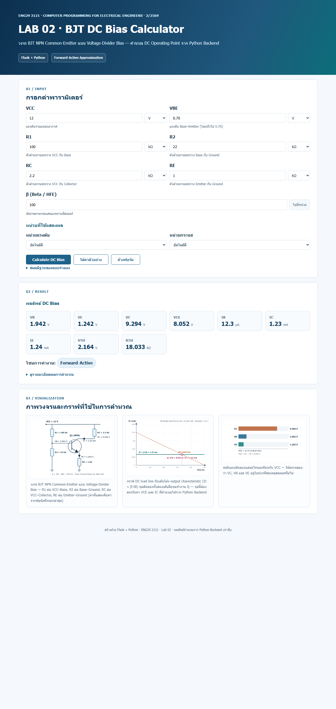
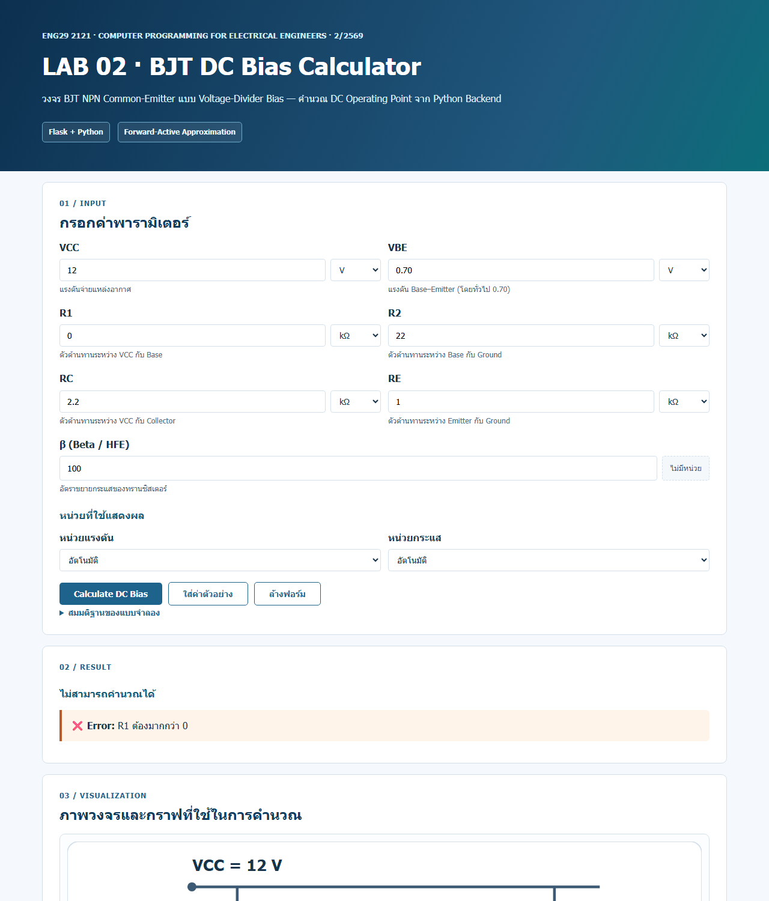
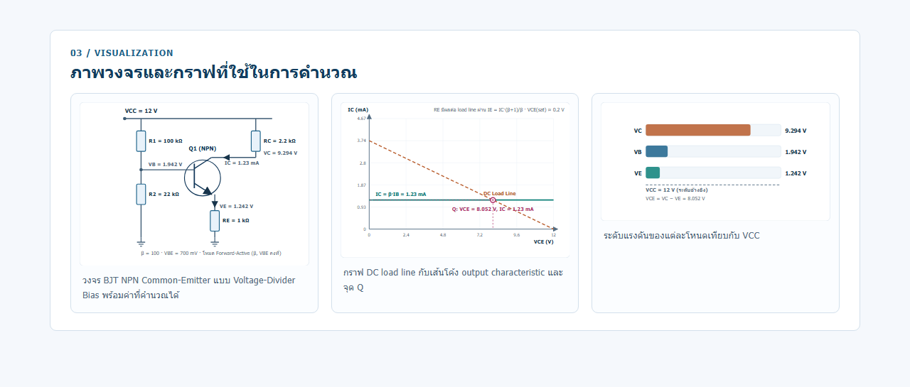

# BJT DC Bias Web App

เว็บแอปพลิเคชัน Flask สำหรับคำนวณ **DC Operating Point** ของวงจร BJT NPN
Common-Emitter แบบ **Voltage-Divider Bias** (ENG29 2121 · Lab 02)

## ภาพรวม

- Frontend: ฟอร์ม HTML + CSS (Jinja template)
- Backend: Flask รับ HTTP request แล้วเรียกฟังก์ชันคำนวณใน Python
- Engineering logic แยกอยู่ใน `dc_bias.py` (ไม่รู้จัก HTML/HTTP)
- **เลือกหน่วยขาเข้าและหน่วยแสดงผลได้** ผ่าน `units.py` (คำนวณภายในยังใช้หน่วย SI เสมอ)
- ภาพประกอบสร้างเองใน `circuit.py` เป็น SVG (ภาพวงจร, กราฟ DC load line, แผนภาพระดับแรงดัน) — ไม่ต้องใช้ไลบรารีภายนอก
- มี automated tests ทั้ง unit test, figure test และ Flask HTTP test

## ข้อกำหนดเบื้องต้น

- Python 3.10 ขึ้นไป
- Git (สำหรับ clone repository)

## การติดตั้งและรัน

```powershell
# 1) เข้าโฟลเดอร์โปรเจกต์
cd "C:\path\to\BJT DC Bias Web App"

# 2) สร้าง virtual environment
python -m venv .venv

# 3) เปิดใช้งาน (Windows PowerShell)
.\.venv\Scripts\Activate.ps1

# 4) ติดตั้ง dependencies
python -m pip install -r requirements.txt

# 5) รันเว็บ
python -m flask --app app run --debug
```

เปิดเบราว์เซอร์ที่ <http://127.0.0.1:5000/>

> หมายเหตุ: ต้องเปิดผ่าน Flask local server เท่านั้น ไม่ใช่ double-click เปิดไฟล์
> `templates/index.html` ด้วย `file://`

## วิธีใช้

1. กรอกค่า VCC (V), VBE (V) และค่าความต้านทาน R1, R2, RC, RE เป็น **kΩ**
2. กรอก β
3. กด **Calculate DC Bias**
4. ระบบจะแสดง VB, VE, VC, VCE (V), IB (μA), IC/IE (mA), VTH, RTH และโซนการทำงาน
5. หากอินพุตผิดหรืออยู่นอกย่าน Forward-Active จะมี Error/Warning แจ้ง
6. ด้านล่างจะแสดง **ภาพวงจร** ที่ใช้คำนวณ, **กราฟ DC load line** พร้อมจุด Q และ **แผนภาพระดับแรงดัน** ของแต่ละโหนด

> ปุ่ม **ใส่ค่าตัวอย่าง** จะกรอกค่าชุดมาตรฐานให้อัตโนมัติ เพื่อทดสอบได้เร็ว
> ปุ่ม **ล้างฟอร์ม** จะเคลียร์ค่าทั้งหมด
> กด **ดูรายละเอียดผลการคำนวณ** เพื่อดูค่ากลางของสมการทุกขั้นตอน

## การเลือกหน่วย

### หน่วยขาเข้า (ตัวเลือกถัดจากช่องกรอก)

| ช่อง | หน่วยที่เลือกได้ |
|---|---|
| VCC, VBE | V, mV |
| R1, R2, RC, RE | Ω, kΩ, MΩ |
| β | ไม่มีหน่วย |

ตัวอย่าง: ถ้ากรอก R1 = 100 และเลือกหน่วย `kΩ` จะเท่ากับ 100,000 Ω
แต่ถ้าเลือก `Ω` ต้องกรอก 100000 ให้ได้ค่าเดียวกัน

### หน่วยขาออก (ส่วน "หน่วยที่ใช้แสดงผล")

| ตัวเลือก | ตัวอย่างผลลัพธ์ |
|---|---|
| แรงดัน = อัตโนมัติ | VB = 1.942 V |
| แรงดัน = mV | VB = 1942.157 mV |
| กระแส = อัตโนมัติ | IC = 1.23 mA, IB = 12.3 µA |
| กระแส = A | IC = 0.001 A, IB = 0.000012 A |

- โหมด **อัตโนมัติ** จะเลือกหน่วยที่เหมาะสมให้แต่ละค่อยโดยอัตโนมัติ
- ตารางรายละเอียดจะแสดงทั้งค่าตามหน่วยที่เลือก และค่า SI เทียบกัน
- หน่วยที่เลือกจะถูกใช้กับภาพวงจรและกราฟด้วย

> ภายในระบบคำนวณทุกอย่างอยู่ในหน่วย SI (V, Ω, A) เสมอ
> การแปลงหน่วยทำที่ขอบระบบใน `app.py` ผ่าน `units.to_si()`

### ค่าตัวอย่างสำหรับทดสอบ

| พารามิเตอร์ | ค่า |
|---|---|
| VCC | 12 V |
| R1 | 100 kΩ |
| R2 | 22 kΩ |
| RC | 2.2 kΩ |
| RE | 1 kΩ |
| β | 100 |
| VBE | 0.70 V |

ผลลัพธ์อ้างอิง (Forward-Active):

| ค่า | ผลลัพธ์ |
|---|---|
| IB | 12.30 μA |
| IC | 1.23 mA |
| IE | 1.24 mA |
| VB | 1.942 V |
| VE | 1.242 V |
| VC | 9.294 V |
| VCE | 8.052 V |

## ภาพหน้าจอ

### ผลลัพธ์ DC Bias (ค่าตัวอย่าง)



### การแสดง Error เมื่อกรอกค่าผิด



### ภาพวงจร กราฟ DC load line และระดับแรงดัน



## ภาพประกอบที่แสดง

| ภาพ | รายละเอียด |
|---|---|
| **ภาพวงจร** | วงจร BJT NPN Voltage-Divider Bias พร้อมค่าที่กรอกและค่าแรงดันที่คำนวณได้ (VB, VE, VC, IC) |
| **กราฟ DC load line** | เส้น load line (VCC → RC/RE) ตัดกับเส้นโค้ง output characteristic (IC = β·IB) พร้อมจุด Q ที่ตรงกับค่าที่คำนวณได้ |
| **แผนภาพระดับแรงดัน** | แถบเทียบระดับ VC, VB, VE กับ VCC เพื่อดูว่าอยู่ในช่วงที่สมเหตุสมผลหรือไม่ |

ทุกภาพสร้างจากค่าที่ผู้ใช้กรอกจริง โดย `circuit.py` คืนค่าเป็นข้อความ SVG
(ไม่พึ่ง matplotlib หรือไลบรารีภายนอก) และทดสอบความถูกต้องได้ด้วย `tests/test_circuit.py`

## สมการที่ใช้

```
VTH = VCC · R2 / (R1 + R2)
RTH = R1·R2 / (R1 + R2)
IB  = (VTH − VBE) / (RTH + (β+1)·RE)
IC  = β·IB
IE  = (β+1)·IB
VE  = IE·RE
VB  = VE + VBE
VC  = VCC − IC·RC
VCE = VC − VE
```

สมมติฐาน: โหมด Forward-Active, β คงที่, VBE คงที่

## การทดสอบ

```powershell
python -m unittest discover -s tests -v
```

ปัจจุบันมี 38 tests: ตรรกะวิศวกรรม, การแปลงหน่วย, การสร้างภาพ SVG, ความสอดคล้องของจุด Q กับ load line และ Flask HTTP routes

## แก้ปัญหาที่พบบ่อย

| อาการ | วิธีแก้ |
|---|---|
| `ModuleNotFoundError: No module named 'flask'` | ยังไม่ได้ activate venv หรือยังไม่ได้ `pip install -r requirements.txt` |
| พิมพ์ `.venv\Scripts\Activate.ps1` แล้ว error | รัน `Set-ExecutionPolicy -Scope CurrentUser -ExecutionPolicy RemoteSigned` แล้วลองใหม่ |
| `CommandNotFoundException` ตอน activate | อยู่ใน PowerShell แต่พิมพ์ path แบบ Git Bash (`/c:/Users/...`) — ต้องใช้ `.\.venv\Scripts\Activate.ps1` |
| เว็บเปิดไม่ได้ | ต้องรันผ่าน Flask server ที่ `http://127.0.0.1:5000/` ไม่ใช่เปิดไฟล์ `templates/index.html` ตรง ๆ |
| Port 5000 ถูกใช้ | เปลี่ยนเป็น `--port 5001` ตอนรัน |

## โครงสร้างโปรเจกต์

```
BJT DC Bias Web App/
├── app.py                  # Flask routes + แปลงหน่วยขาเข้า
├── dc_bias.py              # Engineering calculations (หน่วย SI)
├── units.py                # แปลงหน่วย + จัดรูปแบบผลลัพธ์
├── circuit.py              # สร้าง SVG: ภาพวงจร, DC load line, ระดับแรงดัน
├── templates/index.html    # Input form + results (Jinja)
├── static/
│   ├── style.css           # Layout / presentation
│   ├── app.js              # ปุ่มใส่ค่าตัวอย่าง + ตรวจ input เบื้องต้น
│   └── favicon.svg         # ไอคอนเว็บ
├── tests/
│   ├── test_dc_bias.py     # Unit tests (engineering math)
│   ├── test_units.py       # Unit tests (แปลงหน่วย)
│   ├── test_circuit.py     # Figure tests (SVG + จุด Q บน load line)
│   └── test_web.py         # Flask HTTP tests
├── docs/
│   ├── design-note.md
│   ├── validation.md
│   ├── reflection.md
│   ├── screenshot-result.png
│   ├── screenshot-figures.png
│   └── screenshot-error.png
├── .vscode/launch.json     # เรียกใช้ Flask debug server และเปิด Chrome
├── requirements.txt
├── AGENTS.md
└── README.md
```

## ข้อจำกัด

แบบจำลองนี้ไม่ใช่ SPICE และใช้ได้ดีเฉพาะย่าน Forward-Active
หากวงจรอยู่ในย่าน Cutoff หรือ Saturation เว็บจะแสดง Warning
และไม่ควรถือค่าที่คำนวณได้เป็นผลลัพธ์ที่แม่นยำ
